<a href="https://abdoulrazack1.github.io"></a>

  
  
  
  

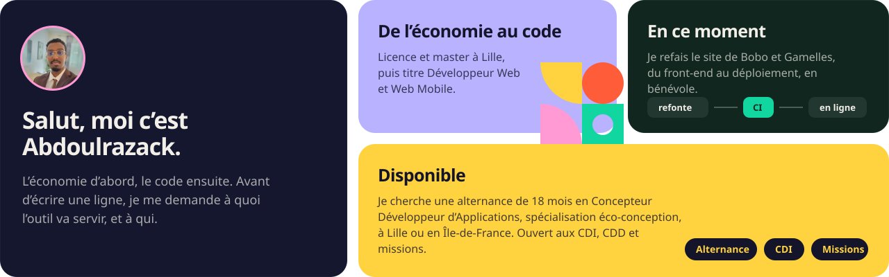

  <a href="https://github.com/Abdoulrazack1/Cycling">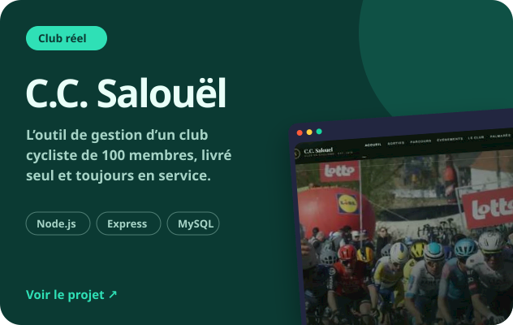</a>
  <a href="https://abdoulrazack1.github.io/projets/cabinet/">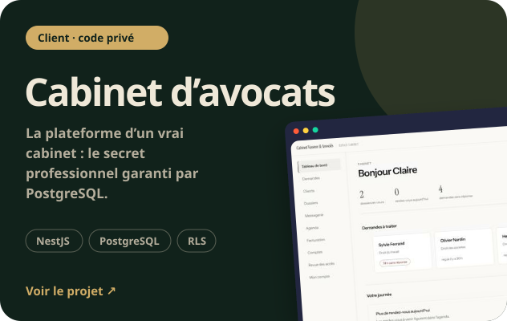</a>
  <a href="https://github.com/Abdoulrazack1/tsundoku">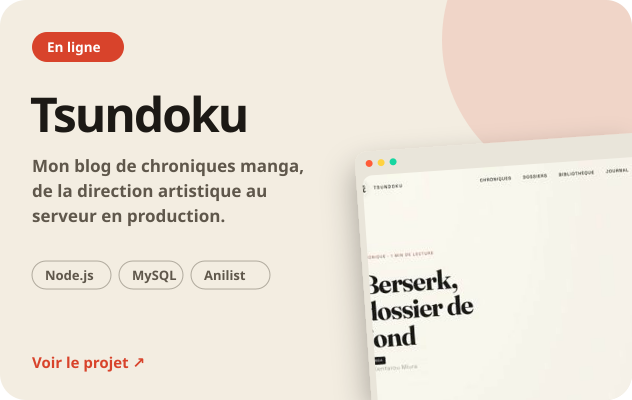</a>
  <a href="https://github.com/Abdoulrazack1/Inko">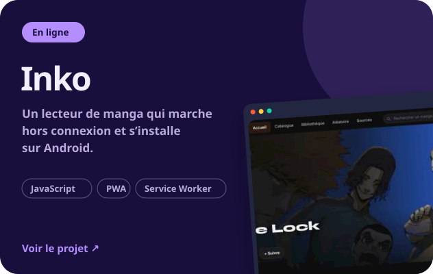</a>
  <a href="https://github.com/Abdoulrazack1/galactic-brain-mcp">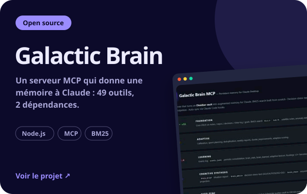</a>
  <a href="https://github.com/Abdoulrazack1/inkstudio">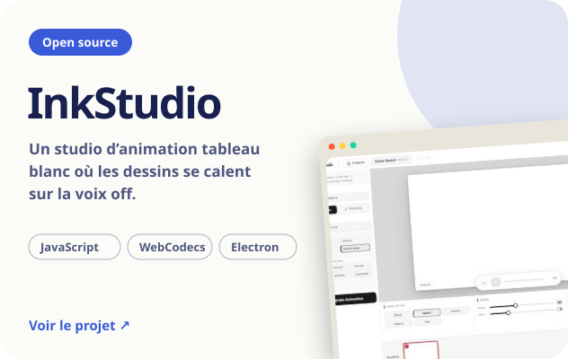</a>
  <a href="https://github.com/Abdoulrazack1/Js-Ranker">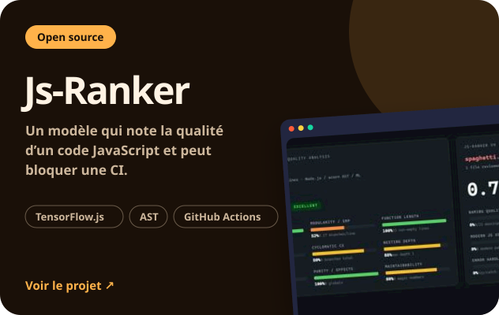</a>
  <a href="https://github.com/Abdoulrazack1/Logic-Lens">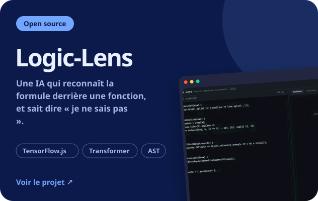</a>

Sites en ligne : <a href="https://tsundoku-s6lz.onrender.com">Tsundoku</a> · <a href="https://abdoulrazack1.github.io/Inko/">Inko</a> · <a href="https://abdoulrazack1.github.io/safari-frenzy/">Safari Frenzy</a> (un mini-jeu, pour le plaisir) · études de cas sur <a href="https://abdoulrazack1.github.io">le portfolio</a>

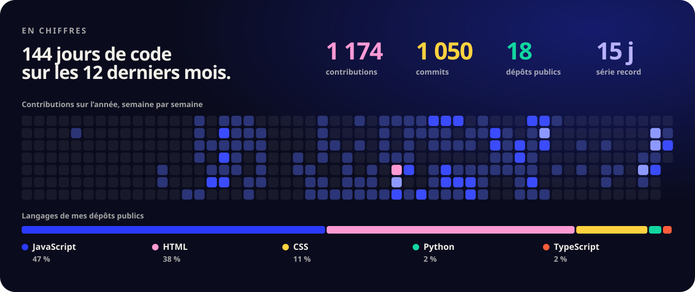

  
  
  
  
  
  
   
  
  
  
  
  
  
   
  
  
  
  
  

